<picture>
  <source media="(prefers-color-scheme: dark)" srcset="./assets/surreal/portrait-dark.svg">
  
</picture>

<b>Thiago Sousa de Paiva</b> 
Software engineer. Backend, mostly Node.js and TypeScript. Automates what repeats. São Paulo, Brazil. 
This page is a picture of a developer. The developer is in the repositories. 
<a href="mailto:thiago_sousap@hotmail.com">thiago_sousap@hotmail.com</a>

### *This is not a stack.*

A stack is the set of decisions that survive a rewrite. These are the names the decisions currently wear.[^1]

| Names | The decision underneath |
|:--|:--|
| TypeScript, JavaScript, Python | The language. One for the browser and the server; Python for the scripts that count things, like the card further down. |
| Node.js, NestJS, Express | The server. Modules and injected dependencies, so the next person can find where a thing lives. |
| React, Next.js | The browser, when the work needs one. |
| PostgreSQL, MongoDB, Redis | Where the data lives, and what is kept close for speed. |
| AWS, GCP, Serverless Framework | Where it runs, and how little of it has to be a server. |
| Docker, GitHub Actions, CI/CD | The same build on every machine, including the one that repaints this page. |
| Jest, Vitest | Proof, kept next to the code. |
| Cursor, Claude | The editor and the second reader. The decisions are still made by hand. |
| Clean Code, SOLID, DDD, event-driven | The rules the rest of this table follows. |

Under all of it, four sentences.

> Readability over cleverness.  
> If it can be automated, it should be.  
> Architecture > frameworks. Frameworks change, good decisions stay.  
> The best code is the code you don't have to write.

### *These are not repositories.*

They are links. The code is on the other side.

| Repository | What it is |
|:--|:--|
| [th-backoffice-api](https://github.com/Thiagosdep/th-backoffice-api) | A back office API. NestJS, TypeORM, PostgreSQL, JWT auth, Swagger docs, Docker. Laid out as clean architecture. |
| [assets-management-api](https://github.com/Thiagosdep/assets-management-api) | A crypto portfolio API. Wallets and their assets, on versioned routes. |
| [adr-patterns](https://github.com/Thiagosdep/adr-patterns) | The template for writing down why a decision was made. |
| [personal-commits-and-branches-patterns](https://github.com/Thiagosdep/personal-commits-and-branches-patterns) | How commits and branches are named. Conventional Commits, followed. |

This is not a door.

 
Behind it: <a href="https://github.com/Thiagosdep/th-backoffice-web">th-backoffice-web</a> (the front of the same back office), <a href="https://github.com/Thiagosdep/blockchain-node">blockchain-node</a>, <a href="https://github.com/Thiagosdep/pm2-lab">pm2-lab</a> and <a href="https://github.com/Thiagosdep/utils">utils</a>.

### *These are not numbers.*

A workflow repaints this card every twelve hours. The numbers are true; the bars are paint.[^2]

To write to the developer rather than the picture: [thiago_sousap@hotmail.com](mailto:thiago_sousap@hotmail.com). Replies in English or Portuguese.

[^1]: Every `|` in this page's source is a table border. None of them is a pipe.
[^2]: The star count is GitHub's. The portrait at the top keeps twelve of its own, at night.
