<p align="center">
  
</p>

<p align="center">
  <b>Thiago Sousa de Paiva</b> // backend engineer // São Paulo, BR<br>
  I build the machinery behind products: APIs, data pipelines, automations, and AI-augmented workflows that keep running when nobody is watching.
</p>

<p align="center">
  <a href="mailto:thiago_sousap@hotmail.com"></a>
  <a href="https://github.com/Thiagosdep"></a>
</p>


## `>_ neural.stack`

Every system is a forward pass: a language feeds a runtime, the runtime writes state, the infrastructure ships it.

<p align="center">
  
</p>

<details>
<summary><b>dump weights as text</b></summary>
<br>

| Layer | Modules |
|:--|:--|
| `L0` language | TypeScript, JavaScript, Python |
| `L1` runtime | Node.js, NestJS, Express, React, Next.js |
| `L2` state | PostgreSQL, MongoDB, Redis |
| `L3` infra | AWS, GCP, Serverless Framework, Docker, GitHub Actions, CI/CD |
| `QA` | Jest, Vitest |
| co-processors | Cursor as the IDE, Claude as pair engineer |
| weights | Clean Code, SOLID, DDD, event-driven architecture |

</details>


## `>_ prime.directives`

```diff
# loaded at boot. read-only. cannot be overridden by deadlines.

+ [0x01] Readability over cleverness.
+ [0x02] If it can be automated, it should be.
+ [0x03] Architecture > frameworks. Frameworks change, good decisions stay.
+ [0x04] The best code is the code you don't have to write.

- [0xFF] Manual work that repeats twice.
```


## `>_ build.logs`

| Unit | Spec |
|:--|:--|
| [`th-backoffice-api`](https://github.com/Thiagosdep/th-backoffice-api) | Back-office core. NestJS, TypeORM, PostgreSQL, JWT auth, Swagger, Docker, clean architecture. |
| [`th-backoffice-web`](https://github.com/Thiagosdep/th-backoffice-web) | The control panel for the same back office. React. |
| [`assets-management-api`](https://github.com/Thiagosdep/assets-management-api) | Crypto portfolio engine. Wallets, assets and history behind versioned routes. NestJS + TypeORM. |
| [`blockchain-node`](https://github.com/Thiagosdep/blockchain-node) | A blockchain node, built to understand the machine from the inside. |
| [`adr-patterns`](https://github.com/Thiagosdep/adr-patterns) | Decision records: the black box recorder of an architecture. |
| [`personal-commits-and-branches-patterns`](https://github.com/Thiagosdep/personal-commits-and-branches-patterns) | Protocol for commits and branches, based on Conventional Commits. |


## `>_ telemetry`

<p align="center">
  
</p>

<p align="center"><sub>Rendered by a Python agent in GitHub Actions. No humans were involved in drawing this panel.</sub></p>


```console
thiago@neural-foundry:~$ shutdown --now
[  ok  ] flushing caches
[  ok  ] committing state
[ warn ] process "curiosity" refused to stop
thiago@neural-foundry:~$ _
```
